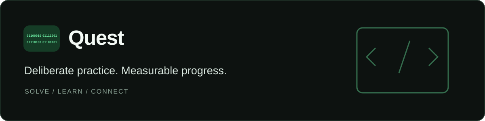
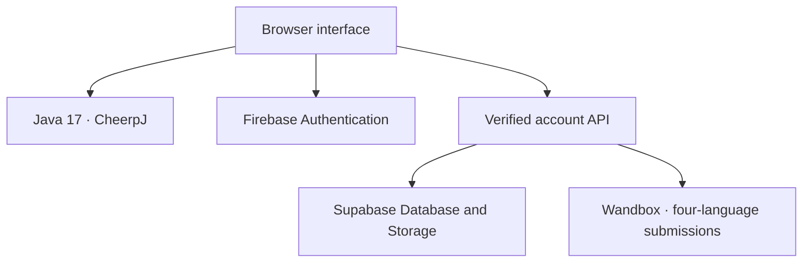

# ByteQuest

**A coding practice platform for building problem-solving confidence, one well-understood solution at a time.**

ByteQuest combines executable problems, guided Java explanations, personal progress analytics and a community of learners. A compact, responsive workspace keeps the problem, editor and test results together, with green accents, the “byte quest” wordmark, a floating glass navigation bar, editorial typography, ambient emerald grids, subtle reveal and spotlight animations, colorful acceptance confetti, and light, dark and system themes. Motion respects reduced-motion preferences.

[**Open ByteQuest**](https://jagadeeshwaran-r.github.io/bytequest/) · [Leaderboard](https://jagadeeshwaran-r.github.io/bytequest/leaderboard.html) · [Backend guide](DATABASE.md) · [Report an issue](https://github.com/jagadeeshwaran-r/bytequest/issues)

[](https://github.com/jagadeeshwaran-r/bytequest/actions/workflows/pages.yml)

## What you can do

| Area | Capabilities |
| --- | --- |
| Problem solving | Search and filter the problem list; view company logos, difficulty, descriptions, constraints and examples; resize the editor and problem panes. |
| Executable practice | Run Java 17 in a browser JVM. Run Python, C and C++ online through the authenticated compiler API; submit all four languages for server-owned acceptance and benchmarks. Inspect public sample/custom cases, compiler diagnostics and return-value comparisons. |
| Code editor | Language-specific suggestions for Java, Python, C and C++; four-space indentation and automatic newlines; Ctrl/Cmd+Z undo and redo; clipboard actions disabled inside the editor. |
| Learning | Explore pattern explanations, invariants, hints, complexity, trade-offs, Java reference solutions and animated reference-algorithm walkthroughs. |
| Progress | Save drafts per language, record first solves, track consecutive UTC accepted-solve days, review on a 2/7/21-day schedule, and export or merge JSON backups. |
| Profiles and friends | Sign in with Google, upload a profile photo, find people from the header, follow learners, view rank, points, solve-only streaks, solved/total progress and follower lists, and compare solving history with multiple or all followed friends. |
| Leaderboards | Switch between Global and Friends rankings on one page. Filter by all time, this week or this month; earn 10/25/50 points for Easy/Medium/Hard, with shared ranks and gold, silver and bronze cups for the top three. |
| Friend chat | Exchange private messages with mutual followers; track unread messages and receive live in-site banners with the sender’s photo or initial. |
| Submissions | Unlock shared solutions after a server-accepted answer for the current revision; rank each learner’s best shared result by runtime or peak memory within one language; view code and explanations. Sharing is off by default. |
| Community updates | Open the inbox popover for new problems and corrections. See photo or initial avatars in temporary friend-online banners and relative last-seen status when shared. |
| Account control | Delete your ByteQuest account after recent Google verification. Private learning records and photos are removed; published community problems remain without account attribution. |
| Problem authoring | Create and publish your own problems from the separate studio, attach private cases, use the company-logo picker, import problem packs and publish correction notes. |

The bundled starter catalog contains **16 original runnable problems across 9 topics, with 81 built-in Java checks**. The live database catalog can grow without redeploying the frontend. A 500-problem import workflow is available; 500 problems are not preloaded in this repository.

## Architecture

The frontend uses native JavaScript modules and static HTML/CSS. GitHub Pages serves the interface; account data and execution services live behind a verified API.



| Component | Implementation |
| --- | --- |
| Frontend | HTML, CSS and native ES modules; no frontend framework or bundler required |
| Java execution | CheerpJ 5.0 with a Java 17 compiler/test bridge; Java submissions use JDK 21 |
| Other languages | Wandbox adapter for online runs and public-suite benchmarks |
| Authentication | Firebase Authentication with Google sign-in |
| Data and files | Supabase Postgres, private Storage and Edge Functions |
| Deployment | GitHub Actions → GitHub Pages |
| Verification | Node.js tests, a real JVM, and native Python/C/C++ checks |

## Run locally

**Prerequisites:** Node.js 22+, a full JDK 17+, and Python 3, GCC and G++ for the complete test suite.

```sh
git clone https://github.com/jagadeeshwaran-r/bytequest.git
cd bytequest
npm ci --ignore-scripts
npm run build
npm test
npx --yes http-server@14.1.1 dist -p 8080 -c-1
```

Open **http://localhost:8080**. Use an HTTP server with byte-range support for the Java runtime; opening HTML directly from the filesystem is insufficient. The repository includes a prebuilt Java bridge, so rebuilding is necessary only when its source changes.

Guest Java practice and local backups work without an account. Cloud features require your own Firebase/Supabase configuration and an explicitly allowed origin. The production account API does not accept localhost requests. See [DATABASE.md](DATABASE.md) before connecting a development deployment.

## How rankings work

- **Global** includes discoverable learner profiles. **Friends** includes your discoverable profile and the discoverable people you follow.
- Each currently published problem counts once, using its earliest synced completion timestamp. Repeated attempts and reviews do not add solves.
- Each first solve earns **10 points for Easy, 25 for Medium, or 50 for Hard**. Equal point totals share a competition rank: for example, **1, 2, 2, 4**. Usernames provide a stable display order within a tie.
- Weekly rankings start on Monday. Week and month boundaries use **UTC**.
- Your rank remains visible in the summary even when your row is outside the current page. Lists are paginated in groups of 25.
- Rankings require sign-in and use synced, self-reported practice progress. They are intended for learning motivation, not verified contest scoring.

Create a discoverable profile to appear in rankings. New profiles default to discoverability and status sharing; saved privacy choices can be changed in **My profile → Edit profile**.

## Accepted submissions and benchmarks

Select **Submit solution** to run your answer against the database-owned test suite. Add an optional approach and complexity explanation. **Share my accepted solution** is unchecked by default. An accepted answer unlocks the **Submissions** tab for that exact problem revision; guest completions and imported progress cannot unlock another learner’s source. Corrected problems require a new acceptance. Your own private accepted history remains available.

Public benchmarks use one warm-up and three measured passes. Runtime is the median duration and excludes compilation/network latency, but includes harness work, serialization and output. Memory is whole-process peak RSS, including the language runtime; it is **not auxiliary space complexity**. Rankings compare each discoverable learner’s best explicitly shared result, separately by language and by runtime or memory.

Java submissions use OpenJDK 21; browser Run remains Java 17. Python uses CPython 3.11.10; C/C++ use GCC 13.2. Small suites, provider scheduling and in-process instrumentation make these practice estimates, not trusted contest scores or proof of Big-O. Complexity annotations are author-stated and do not determine rank. A configured private Java judge uses its own execution metrics for the complete public and hidden suite. Hidden inputs are never sent to Wandbox.

## Private friend chat and live alerts

Use **Messages** in the glass header or **Message** on a followed profile. Sending requires mutual follows and discoverable profiles. Participant-only API checks protect conversation history; the project owner administers the database. Unfollowing disables new messages while participants retain existing history.

A Firebase-authorized POST event stream delivers messages and online transitions while the page is focused and visible. Tokens stay in headers. Durable per-account cursors recover missed events after reconnects; short polling provides a fallback. Initial online snapshots remain quiet, and real transitions have a short cooldown. These are website banners, not device push notifications. Delivery uses backend requests and is subject to hosting quotas.

## Add or update a problem

1. Sign in and open **Problem studio** from the profile menu.
2. Create a definition or import a problem JSON file. Add a statement, constraints, examples, Java contract, starter/reference code, explanations and test cases.
3. Validate the Java reference against the public cases.
4. Save a draft or enable **Published** and save. Updates to a published problem require a correction note.

Every verified learner can author and manage their own problems. Explicit library editors and administrators can manage the wider catalog; role permissions are enforced by the backend. Publishing updates the database catalog and creates an in-app announcement.

The current function protocol supports `int`, `int[]`, `boolean` and ASCII `String` parameters/results. See [DATABASE.md](DATABASE.md) for author ownership, private suites and deployment details.

## Deploy with GitHub Pages

1. Fork the repository and keep the default branch as `main`.
2. In **Settings → Pages → Build and deployment**, select **GitHub Actions**.
3. Configure your Firebase project, Supabase project and allowed origins as described in [DATABASE.md](DATABASE.md).
4. Push to `main`, or run **Build, test and deploy ByteQuest** from the Actions tab.

The workflow installs pinned dependencies, builds the Java bridge, runs the verification suite and deploys `dist/`. The frontend can use GitHub Pages' public-repository hosting; Firebase, Supabase, CheerpJ and compiler providers have their own terms and quotas.

## Security and privacy

Firebase signs the identity token; the Edge Function verifies its signature, project, expiry, Google provider and verified email. Every private request derives ownership from that verified identity. Request-body IDs and role flags cannot grant account or authoring access.

Private account tables use RLS and are inaccessible to direct browser roles. Only the backend uses the Supabase service credential. Browser configuration files contain public web configuration and a publishable key; secrets never belong in `dist/` or Git.

Uploaded avatars use a private Storage bucket with expiring signed links. Discoverable profiles and leaderboards expose selected profile fields and aggregate practice counts, excluding emails, Firebase IDs, source drafts and notes. Presence requires a focused, visible page and interaction within 30 seconds; shared last seen uses relative time.

Java Run executes on the learner’s device. Python/C/C++ runs and signed-in submissions in all four languages send code and public test data to the configured online compiler. Review the [privacy notice](https://jagadeeshwaran-r.github.io/bytequest/privacy.html) and [backend guide](DATABASE.md) for the current data flow.

## Verification

```sh
npm ci --ignore-scripts
npm run build
npm test
```

The suite covers four-language benchmark harnesses, authenticated event streams, real Java reference solutions and diagnostics, native Python/C/C++ harnesses, authentication and owner isolation, progress merging, author permissions, image validation, presence, friend alerts, leaderboard requests, language suggestions, editor history, smooth chart paths and account deletion safeguards. Rollback-only database fixtures in `tests/leaderboard.sql`, `tests/upgrades.sql` and `tests/social-submissions.sql` additionally check weighted/shared ranks, time windows, comparison privacy, pagination, account-removal cascades, anonymization, retry behavior and service-only function permissions. No real account is deleted during validation.

## Repository guide

| Path | Responsibility |
| --- | --- |
| `dist/index.html`, `dist/app.js` | Problem list and coding workspace |
| `dist/leaderboard.*`, `dist/leaderboard-model.js` | Global/Friends ranking page and request handling |
| `dist/community.*`, `dist/dashboard.*` | Profiles, social features and profile analytics |
| `dist/shell.js`, `dist/presence*.js`, `dist/live-events.js`, `dist/chat.js` | Glass header, activity leases, live alerts and private messages |
| `dist/submissions.js`, `dist/celebration.js` | Solution rankings, optional sharing, source viewer and confetti |
| `dist/studio.*`, `dist/catalog.js`, `dist/bulk-import.js` | Problem authoring and import validation |
| `dist/cloud.js`, `dist/firebase-session.js` | Authenticated client requests and session handling |
| `supabase/functions/bytequest-firebase/` | Verified account API, database access and compiler adapters |
| `database/` | Schema evolution, catalog seeds and service-only database functions |
| `java/`, `scripts/build-java.mjs` | Browser Java compiler/test bridge |
| `tests/` | Application, security, execution and database verification |
| `.github/workflows/pages.yml` | Build, test and deployment pipeline |

## Current limits

The first Java session downloads a browser JVM and compiler resources; preloading and warm-up reduce later waits, but cold starts depend on the device and network. Java explanations and reference solutions remain the teaching source for all supported languages. Animations illustrate the reference algorithm rather than tracing arbitrary submitted code.

Private tests are stored separately from the public catalog. A server-side Java judge adapter exists, but the hosted private judge is **not configured**. Problems requiring hidden-case acceptance cannot complete through that path until a trusted isolated judge is connected. Public-case practice remains available.

## Contributing

Open an issue with a reproducible example, expected behavior and relevant browser/language details. Keep pull requests focused, run the test suite, and include validation results. For new problems, provide original or appropriately licensed statements, reference code and meaningful edge cases. Do not add third-party copyrighted problem packs or credentials.

## License and acknowledgments

ByteQuest source is available under the [MIT License](LICENSE).

Built with [CheerpJ](https://cheerpj.com/) by Leaning Technologies. CheerpJ is loaded from its official CDN and is governed by its [own licensing terms](https://cheerpj.com/docs/licensing). Firebase, Supabase, Wandbox and bundled fonts retain their respective terms. Company marks identify community-reported tags and do not imply endorsement; asset sources are recorded in [the company-logo notice](dist/assets/companies/NOTICE.md).
