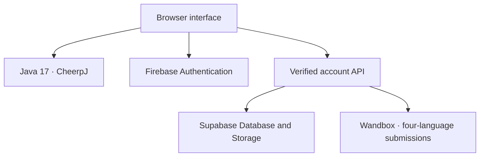

# ByteQuest

**A coding practice platform for building problem-solving confidence, one well-understood solution at a time.**

ByteQuest combines executable problems, guided Java explanations, personal progress analytics and a community of learners. A compact, responsive workspace keeps the problem, editor and test results together, with green accents, the “byte quest” wordmark, a floating glass navigation bar, editorial typography, ambient emerald grids, subtle reveal and spotlight animations, colorful acceptance confetti, and light, dark and system themes. Motion respects reduced-motion preferences.

[**Open ByteQuest**](https://jagadeeshwaran-r.github.io/bytequest/) · [Leaderboard](https://jagadeeshwaran-r.github.io/bytequest/leaderboard.html) · [Backend guide](DATABASE.md) · [Report an issue](https://github.com/jagadeeshwaran-r/bytequest/issues)

[](https://github.com/jagadeeshwaran-r/bytequest/actions/workflows/pages.yml)

## What you can do

| Area | Capabilities |
| --- | --- |
| Problem solving | Search and filter the problem list; view company logos, difficulty, descriptions, constraints and examples; resize the editor and problem panes. |
| Executable practice | Run and Submit Java 17 in the browser JVM without a hosted compiler. Java Submit checks published public cases (and optional custom cases), records a private browser practice submission (code snapshot, verdict, timestamp and revision), and syncs bounded history with progress. It does not run hidden tests or create a server-verified submission. Python, C and C++ keep their authenticated server-verified submissions and benchmarks. Inspect public sample/custom cases, compiler diagnostics and return-value comparisons. Failed submissions show a notification and a persistent verdict with failed public-case details. |
| Code editor | Language-specific suggestions for Java, Python, C and C++; automatic bracket pairs and selection wrapping; comparison-aware Java/C++ angle brackets; four-space indentation and automatic newlines; Ctrl/Cmd+Z undo and redo; native copy enabled; paste, drag-drop and cut disabled inside the editor. Operators display literally, and Run/Submit repairs math comparison symbols outside quoted strings and comments, with undo support. |
| Learning | Explore pattern explanations, invariants, hints, complexity, trade-offs, Java reference solutions and animated reference-algorithm walkthroughs. |
| Progress | Save drafts per language, record first solves, track consecutive UTC accepted-solve days, review on a 2/7/21-day schedule, and export or merge JSON backups. |
| Profiles and friends | Sign in with Google, upload a photo, find and follow learners, view shimmering gold/silver/bronze names and cups, colorful solved/points/streak cards, the three newest solved problems with an expandable 25-problem history, month-separated solving calendars, solve-derived skills and language badges. Add optional organization and LinkedIn links; open follower lists beneath the name and compare solving history with followed friends. |
| Leaderboards | Switch between Global and Friends rankings on one page. Filter by all time, this week or this month; earn 10/25/50 points for Easy/Medium/Hard, with shared ranks and gold, silver and bronze cups for the top three. |
| Friend chat | Exchange private messages with mutual followers; see privacy-aware green online dots and Sent/Seen receipts; track unread messages and receive live in-site banners with the sender’s photo or initial. |
| Submissions | Unlock shared solutions after a server-accepted answer for the current revision; view all languages by default, optionally filter one language, and rank each learner’s best shared result per language by runtime or peak memory. Sharing is off by default. |
| Community updates | One Messages & updates dialog combines private chat and problem announcements. Receive live in-site new-problem and correction banners, catch up on unread updates, and see friend-online alerts with photo or initial avatars. |
| Account control | Delete your ByteQuest account after recent Google verification. Private learning records and photos are removed; published community problems remain without account attribution. |
| Problem authoring | Create and publish your own problems from the separate studio, attach private cases, use the company-logo picker, import problem packs and publish correction notes. Administrators can find creator accounts by username, profile ID or exact Firebase user ID before granting access. |

The bundled starter catalog contains **16 original runnable problems across 9 topics, with 81 built-in Java checks**. The live database catalog can grow without redeploying the frontend. A 500-problem import workflow is available; 500 problems are not preloaded in this repository.

## Architecture

The frontend uses native JavaScript modules and static HTML/CSS. GitHub Pages serves the interface; account data and execution services live behind a verified API.



| Component | Implementation |
| --- | --- |
| Frontend | HTML, CSS and native ES modules; no frontend framework or bundler required |
| Java execution | CheerpJ 5.0 with a Java 17 compiler/test bridge; Java Run and practice Submit use the browser JDK 17 |
| Other languages | Wandbox adapter for online runs and public-suite benchmarks |
| Authentication | Firebase Authentication with Google sign-in |
| Data and files | Supabase Postgres, private Storage and Edge Functions |
| Deployment | GitHub Actions → GitHub Pages |
| Verification | Node.js tests, a real JVM, and native Python/C/C++ checks |

## Run locally

**Prerequisites:** Node.js 22+, a full JDK 17+, and Python 3, GCC and G++ for the complete test suite.

```sh
git clone https://github.com/jagadeeshwaran-r/bytequest.git
cd bytequest
npm ci --ignore-scripts
npm run build
npm test
npx --yes http-server@14.1.1 dist -p 8080 -c-1
```

Open **http://localhost:8080**. Use an HTTP server with byte-range support for the Java runtime; opening HTML directly from the filesystem is insufficient. The repository includes a prebuilt Java bridge, so rebuilding is necessary only when its source changes.

Guest Java practice and local backups work without an account. Cloud features require your own Firebase/Supabase configuration and an explicitly allowed origin. The production account API does not accept localhost requests. See [DATABASE.md](DATABASE.md) before connecting a development deployment.

## How rankings work

- **Global** includes discoverable learner profiles. **Friends** includes your discoverable profile and the discoverable people you follow.
- Each currently published problem counts once, using its earliest synced completion timestamp. Repeated attempts and reviews do not add solves.
- Each first solve earns **10 points for Easy, 25 for Medium, or 50 for Hard**. Equal point totals share a competition rank: for example, **1, 2, 2, 4**. Usernames provide a stable display order within a tie.
- Weekly rankings start on Monday. Week and month boundaries use **UTC**.
- Your rank remains visible in the summary even when your row is outside the current page. Lists are paginated in groups of 25.
- Rankings require sign-in and use synced, self-reported practice progress. They are intended for learning motivation, not verified contest scoring.

Create a discoverable profile to appear in rankings. New profiles default to discoverability and status sharing; saved privacy choices can be changed in **My profile → Edit profile**.

## Progress save reliability

The Problems page preserves unreadable local progress rather than overwriting it with an empty backup. If the primary browser record is damaged or incompatible, new work is written under a separate owner-scoped `.recovery` key while the original stays untouched; an unreadable recovery copy also blocks overwriting. A storage failure is shown explicitly and cannot trigger a saved-solve celebration. When signing out, ByteQuest first tries to sync the latest work; if offline or another sync is pending, it warns about unsynced changes and requires explicit confirmation before signing out anyway. **Export a backup** regularly. These guards do not make a failed browser storage device durable or resurrect already lost code.

## Accepted submissions and benchmarks

For **Java**, **Submit solution** uses the same browser compiler as **Run**, saves each attempted solution and outcome in **My submissions**, checks published public and added custom cases, and marks the quest solved for practice when they pass. Hidden tests are not checked and no verified submission or shared code is created; the browser practice solve can sync to your progress and self-reported leaderboards. For Python, C and C++, **Submit solution** uses the authenticated server judge, with optional approach and complexity notes. **Share my accepted solution** is selected by default for those verified submissions. An accepted answer unlocks the **Submissions** tab for that exact problem revision; guest completions and imported progress cannot unlock another learner’s source. Corrected problems require a new acceptance. Your own private accepted history remains available.

Public Python/C/C++ benchmarks use one warm-up and three measured passes; Java uses a single suite pass. Runtime is the median duration and excludes compilation/network latency, but includes harness work, serialization and output. Memory is whole-process peak RSS, including the language runtime; it is **not auxiliary space complexity**. Rankings start with **All languages**, with one best explicitly shared result per discoverable learner and language. Filter a language for closer comparisons: runtime and memory overhead differ across languages. Runtime and memory have separate ranking orders.

Java browser practice uses Java 17 for both Run and Submit; previously recorded server Java benchmarks used OpenJDK 21. Python uses CPython 3.11.10; C/C++ use GCC 13.2. Small suites, provider scheduling and in-process instrumentation make these practice estimates, not trusted contest scores or proof of Big-O. Complexity annotations are author-stated and do not determine rank. A configured private Java judge uses its own execution metrics for the complete public and hidden suite. Hidden inputs are **not** sent to Wandbox by default; setting the server-only `BYTEQUEST_ALLOW_EXTERNAL_HIDDEN_JUDGE=true` explicitly permits that third-party disclosure when the trusted private judge is unavailable.

C++ keeps its normal compiler diagnostics and adds ByteQuest problem-contract checks. The declared result type must match the problem. For integer-returning problems, returning a boolean expression is rejected rather than silently converting it to 0/1; use an explicit `int` conversion when that is intentional. Boolean-returning problems require boolean values. Checks apply to the problem function's direct returns, preserve recursive calls and skip nested lambdas/local classes; macro-generated return statements are not a full C++ AST analysis. Ordinary comparisons and sorting predicates remain valid.


## Public Java runner resilience

Authenticated Java public-suite submissions are checked on the server. ByteQuest first tries a **Judge0 JDK 17** endpoint and switches to **Wandbox** only on a provider-availability failure, not on a wrong answer or compilation error. Neither runner is sent private hidden cases by this public-only path. Full hidden suites still use the existing explicitly configured private judge path.

The default `https://ce.judge0.com` endpoint is a **shared public demonstration** without a production availability guarantee. For reliable production traffic, provision a dedicated or managed Judge0 instance and configure its secret settings in Supabase: `BYTEQUEST_PUBLIC_JUDGE0_URL` (HTTPS base URL), optional `BYTEQUEST_PUBLIC_JUDGE0_KEY` (server only), and `BYTEQUEST_PUBLIC_JAVA_LANGUAGE_ID` (91 for the tested JDK 17 image; check your own instance's languages endpoint). Never embed the provider key in GitHub Pages, and restrict access to the judge behind network and token controls. The source is submitted by the existing authenticated, rate-limited backend, not directly from the browser.

A successful alternate-provider public test run is recorded as an accepted but **private and unranked** submission; it unlocks the current problem revision's reference and eligible community reading, but it does not assert hidden-test acceptance or comparable runtime rankings. Infrastructure failures preserve drafts without unlocking solutions. Browser-only practice remains unverified.

## Private friend chat and live alerts

Use **Messages and updates** in the glass header, then choose **Messages** or **Updates**. The single badge combines unread conversations and community updates. You can also choose **Message** on a followed profile. Sending requires mutual follows and discoverable profiles. Participant-only API checks protect conversation history; the project owner administers the database. Unfollowing disables new messages while participants retain existing history. Green chat dots use the existing 30-second, privacy-aware presence lease. A focused, visible conversation marks incoming messages read through the newest visible message; senders see Seen receipts update through the live account feed. Messages outside the current read range remain unread.

A Firebase-authorized POST event stream delivers messages, online transitions and problem announcements while the page is focused and visible. Tokens stay in headers. Separate private-event and shared-announcement cursors recover missed events after reconnects; short polling provides a fallback. Initial snapshots remain quiet. Newly published problems and corrections are available to every signed-in account, including accounts without a discoverable profile; missed updates remain in Updates with a private read cursor. These are website banners, not device push notifications. Delivery uses backend requests and is subject to hosting quotas.

## Add or update a problem

1. Sign in and open **Problem studio** from the profile menu.
2. Create a definition or import a problem JSON file. Add a statement, constraints, examples, Java contract, starter/reference code, explanations and test cases.
3. Validate the Java reference against the public cases.
4. Save a draft or enable **Published** and save. Updates to a published problem require a correction note.

Every verified learner can author and manage their own problems. Explicit library editors and administrators can manage the wider catalog; role permissions are enforced by the backend. Publishing updates the database catalog and creates an in-app announcement. Original authorship is stored independently of later editors and shown below the problem title with a profile link when the author is discoverable. The original bundled problems carry a ByteQuest collection credit.

The current function protocol supports `int`, `int[]`, `boolean` and ASCII `String` parameters/results. See [DATABASE.md](DATABASE.md) for author ownership, private suites and deployment details.

## Deploy with GitHub Pages

1. Fork the repository and keep the default branch as `main`.
2. In **Settings → Pages → Build and deployment**, select **GitHub Actions**.
3. Configure your Firebase project, Supabase project and allowed origins as described in [DATABASE.md](DATABASE.md).
4. Push to `main`, or run **Build, test and deploy ByteQuest** from the Actions tab.

The workflow installs pinned dependencies, builds the Java bridge, runs the verification suite and deploys `dist/`. The frontend can use GitHub Pages' public-repository hosting; Firebase, Supabase, CheerpJ and compiler providers have their own terms and quotas.

## Security and privacy

Firebase signs the identity token; the Edge Function verifies its signature, project, expiry, Google provider and verified email. Every private request derives ownership from that verified identity. Request-body IDs and role flags cannot grant account or authoring access.

Private account tables use RLS and are inaccessible to direct browser roles. Only the backend uses the Supabase service credential. Browser configuration files contain public web configuration and a publishable key; secrets never belong in `dist/` or Git.

Uploaded avatars use a private Storage bucket with expiring signed links. Discoverable profiles and leaderboards expose selected profile fields and aggregate practice counts, excluding emails, Firebase IDs, source drafts and notes. Presence requires a focused, visible page and interaction within 30 seconds; shared last seen uses relative time.

**My profile → Edit profile** includes optional company, organization or university details, an HTTPS website and a LinkedIn profile link. These are self-reported and follow profile discoverability. Known companies use bundled logos; other organizations use a building icon. Skills count distinct solved published problems by topic. Language badges count distinct problems with server-accepted submissions in that language; older progress without language evidence remains unassigned.

Java Run and practice Submit execute on the learner’s device without sending Java code to an online compiler; signed-in practice history (up to 35 recent attempts with up to 20,000 code characters each) is privately synced through the existing Firebase-authenticated progress API, never published as verified source. Older solves can show dates, but previously unrecorded code cannot be reconstructed. Python/C/C++ runs and signed-in verified submissions send code and public test data to the configured online compiler. Review the [privacy notice](https://jagadeeshwaran-r.github.io/bytequest/privacy.html) and [backend guide](DATABASE.md) for the current data flow.

## Verification

```sh
npm ci --ignore-scripts
npm run build
npm test
```

The suite covers four-language benchmark harnesses, authenticated event streams, real Java reference solutions and diagnostics, native Python/C/C++ harnesses, authentication and owner isolation, progress merging, author permissions, image validation, presence, friend alerts, leaderboard requests, language suggestions, editor history, smooth chart paths, month boundaries and optional profile-link validation. Rollback-only database fixtures in `tests/leaderboard.sql`, `tests/upgrades.sql`, `tests/social-submissions.sql` and `tests/profile-inbox.sql` additionally check ranks, comparison privacy, account-removal cascades, authorship, global announcements, accepted-language evidence, source gates and service-only permissions. Validation does not message real learners or delete real accounts.

## Repository guide

| Path | Responsibility |
| --- | --- |
| `dist/index.html`, `dist/app.js` | Problem list and coding workspace |
| `dist/leaderboard.*`, `dist/leaderboard-model.js` | Global/Friends ranking page and request handling |
| `dist/community.*`, `dist/dashboard.*` | Profiles, social features and profile analytics |
| `dist/shell.js`, `dist/presence*.js`, `dist/live-events.js`, `dist/chat.js` | Glass header, activity leases, live alerts and private messages |
| `dist/submissions.js`, `dist/celebration.js` | Solution rankings, optional sharing, source viewer and confetti |
| `dist/studio.*`, `dist/catalog.js`, `dist/bulk-import.js` | Problem authoring and import validation |
| `dist/cloud.js`, `dist/firebase-session.js` | Authenticated client requests and session handling |
| `supabase/functions/bytequest-firebase/` | Verified account API, database access and compiler adapters |
| `database/` | Schema evolution, catalog seeds and service-only database functions |
| `java/`, `scripts/build-java.mjs` | Browser Java compiler/test bridge |
| `tests/` | Application, security, execution and database verification |
| `.github/workflows/pages.yml` | Build, test and deployment pipeline |

## Compiler availability

The public compiler may temporarily fail to start a sandbox (for example, an OCI/crun resource error). ByteQuest retries a recognized container-capacity or transient HTTP failure at most twice, using the same program and compiler within the original deadline. If it still cannot run, the site shows a compiler-availability message, keeps the draft, and records no solution verdict, failed practice attempt, points or ranking entry. Syntax errors and programs that already executed are not automatically retried. C++ allows 60 seconds for Run and 75 seconds for submission benchmarks, with longer browser request limits to leave room for authentication and database work. A timeout has a separate message from a provider outage. Redacted transport logs record compiler, failure category, HTTP status and timing; source code, tokens and profile data are excluded. Java **Run** remains available in the browser while the remote service is unavailable; hung Java runs reset the iframe after 90 seconds. Malformed or repeated benchmark markers are rejected without recording acceptance. The shared hosted compiler is for practice, not a hardened anti-cheat or isolation boundary for ranked contests.

## Current limits

The first Java session downloads a browser JVM and compiler resources; preloading and warm-up reduce later waits, but cold starts depend on the device and network. Java explanations and reference solutions remain the teaching source for all supported languages. Animations illustrate the reference algorithm rather than tracing arbitrary submitted code.

Private tests are stored separately from the public catalog. A server-side Java judge adapter exists, but the hosted private judge is **not configured**. The Java browser practice Submit path does not depend on it; hidden cases are intentionally not checked during browser practice. By default, hidden-suite submissions fail closed until a trusted isolated judge is connected. The server-only `BYTEQUEST_ALLOW_EXTERNAL_HIDDEN_JUDGE=true` setting is an explicit exception: it sends private cases to Wandbox, so enable it only after accepting that data-sharing risk. Public-case practice remains available.

## Contributing

Open an issue with a reproducible example, expected behavior and relevant browser/language details. Keep pull requests focused, run the test suite, and include validation results. For new problems, provide original or appropriately licensed statements, reference code and meaningful edge cases. Do not add third-party copyrighted problem packs or credentials.

## License and acknowledgments

ByteQuest source is available under the [MIT License](LICENSE).

Built with [CheerpJ](https://cheerpj.com/) by Leaning Technologies. CheerpJ is loaded from its official CDN and is governed by its [own licensing terms](https://cheerpj.com/docs/licensing). Firebase, Supabase, Wandbox and bundled fonts retain their respective terms. Company marks identify community-reported tags and do not imply endorsement; asset sources are recorded in [the company-logo notice](dist/assets/companies/NOTICE.md).
